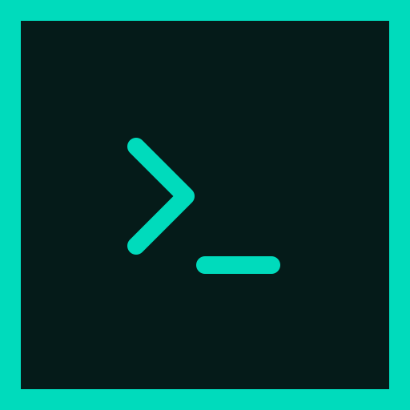
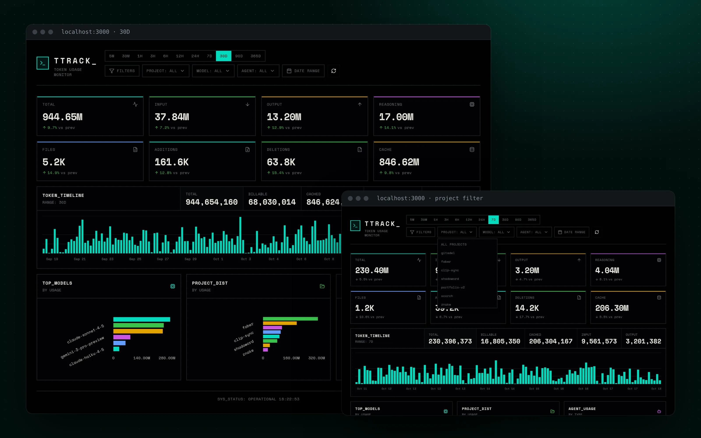
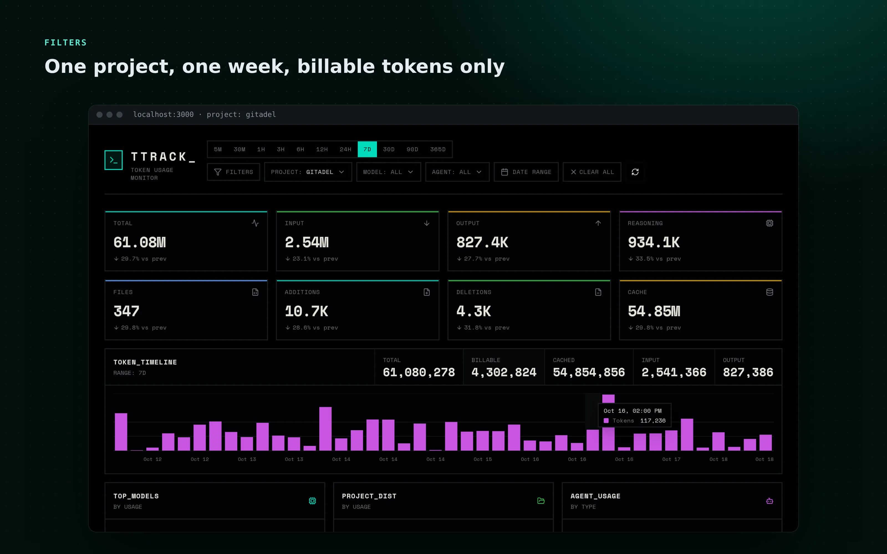
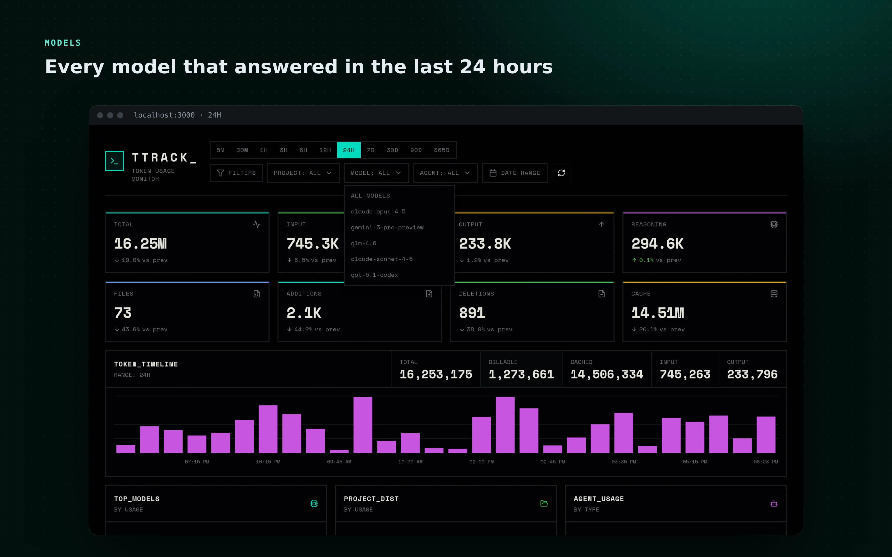
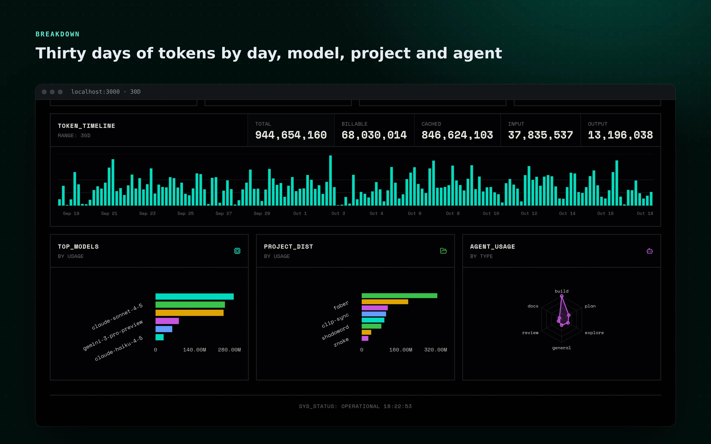

<p align="center">
  
</p>

<p align="center">
  <a href="https://nextjs.org"></a>
  <a href="https://docs.influxdata.com/influxdb/v2/"></a>
  <a href="https://bun.sh"></a>
</p>

<h1 align="center">TTrack</h1>

<p align="center">
  
</p>

<p align="center">
  A dashboard that shows where your AI coding tokens went.
</p>

TTrack records every assistant turn from OpenCode and the Codex CLI into InfluxDB, then puts it on one page: input, output, reasoning and cache tokens, per project, model and agent, over any range from five minutes to a year. It is for people who run coding agents across several repositories and want to know which ones eat the budget, without opening each provider's billing page.

- **Collect** turns automatically, with an OpenCode plugin and a `notify` hook for Codex. Each turn also carries the lines added and removed and the files it touched.
- **Compare** any range with the one before it, and split the totals by project, model and agent.
- **Separate** billable tokens (input, output, reasoning) from cache reads, which are usually most of the total and cost far less.

## Quick start

```bash
git clone https://github.com/Fractal-Tess/TTrack.git
cd TTrack
docker compose up -d
```

This starts InfluxDB on port 8086 and the dashboard on [localhost:3000](http://localhost:3000). The dashboard stays empty until a collector sends something. To hook up OpenCode:

```bash
bun install
bun run --cwd apps/opencode-plugin build
apps/opencode-plugin/install-global.sh
```

Then write the InfluxDB details to `~/.config/opencode/ttrack.json` and restart OpenCode:

```json
{
  "influxdb": {
    "url": "http://localhost:8086",
    "token": "ttrack-dev-token",
    "org": "ttrack",
    "bucket": "token_usage"
  }
}
```

Codex setup, manual InfluxDB setup and the environment variables are in [INSTALL.md](INSTALL.md).

## A closer look

<table>
  <tr>
    <td></td>
    <td></td>
  </tr>
  <tr>
    <td colspan="2"></td>
  </tr>
</table>

## More

- [INSTALL.md](INSTALL.md): running the stack, the OpenCode plugin and the Codex hook
- [CONTRIBUTING.md](CONTRIBUTING.md): repository layout, development and remaking the README images
